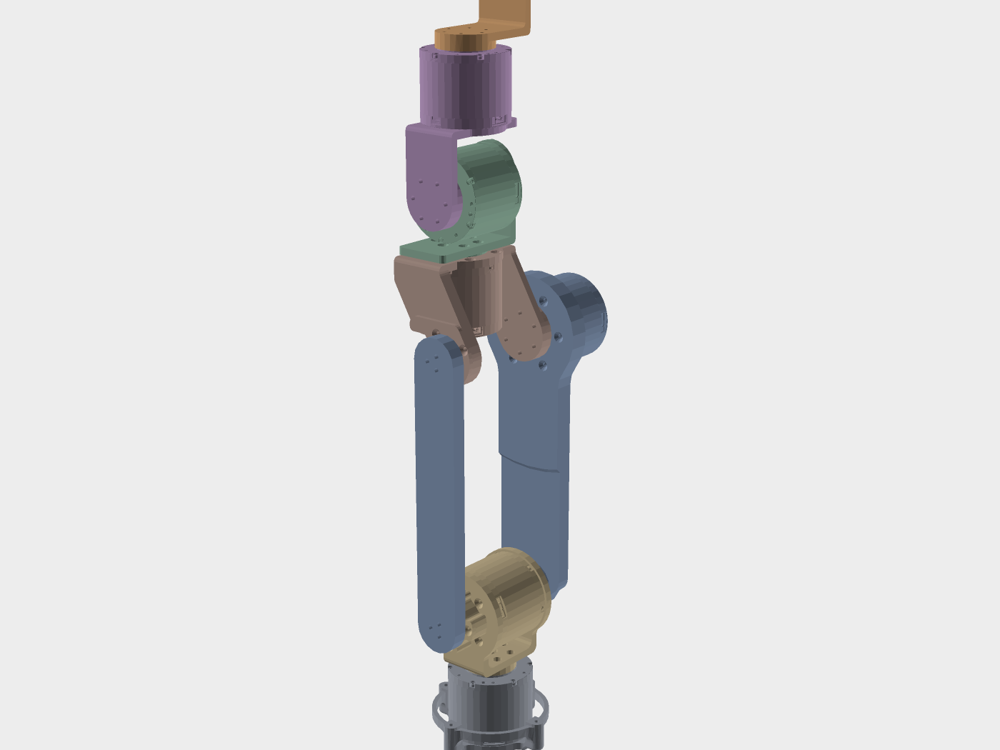

# ros2_gong

达妙 DM4310 六轴机械臂的 ROS 2 Jazzy 工作空间：URDF 模型、ros2_control CAN 硬件插件，以及零位标定 / 重力补偿 / 可视化调试工具。

RViz 2 里显示的是真机姿态，`ros2_control` 通过 CAN（1 Mbps）直接驱动 6 台电机；不接硬件时也能用 RViz 滑条或浏览器里的 viser 界面做离线调试。

## 目录结构

```text
ros2_gong/
├── src/
│   ├── robotarm/                # 描述包（纯资源）：URDF、mesh、RViz 配置、launch、控制器参数
│   └── robotarm_hardware/       # ros2_control SystemInterface 插件：达妙 DM4310 × 6，走 CAN
├── tools/                       # 独立调试脚本：标定、重力补偿、电机监视、viser 可视化
├── start.sh                     # 一键启动：检查 can0 → 必要时编译 → ros2_control + RViz
└── 文档                          # 开发笔记（CAN 命令、重力补偿原理等）
```

两个 ROS 2 包：

| 包 | 说明 |
| --- | --- |
| `robotarm` | `robotarm.urdf`（sw2urdf 导出后移植到 Jazzy）、7 个 STL mesh、RViz 配置、3 个 launch、`config/` 下的控制器与标定参数 |
| `robotarm_hardware` | `robotarm_hardware::DmSystemHardware`，实现 `hardware_interface::SystemInterface`，读寄存器 `0x51` 拿角度、发 MIT 帧下发位置/力矩 |

关节为 `J0`–`J5`，CAN ID `1`–`6`，接口名 `can0`（见 `src/robotarm/urdf/robotarm.urdf` 里的 `<ros2_control>` 段）。

## 硬件与环境

- Ubuntu 24.04 + ROS 2 Jazzy
- 达妙 DM4310 电机 × 6，CAN 1 Mbps
- PCAN-USB 适配器，`peak_usb` 驱动，接口名 `can0`

## 依赖

```bash
sudo apt install ros-jazzy-ros2-control ros-jazzy-ros2-controllers \
                 ros-jazzy-xacro ros-jazzy-rviz2 ros-jazzy-pinocchio \
                 ros-jazzy-joint-state-publisher ros-jazzy-joint-state-publisher-gui \
                 python3-can python3-numpy python3-yaml
```

浏览器可视化（`tools/arm_viser.py`）另需：

```bash
python3 -m pip install viser trimesh yourdfpy
```

> 本机是把这三个包装到 `tools/viser-libs/` 里再由脚本加入 `sys.path` 的：让系统的 numpy 1.26 优先，避免 numpy 2 与 pinocchio 冲突。装到别处可能触发 pinocchio 段错误。

## 快速开始

```bash
# 1. CAN 接口（每次上电 / 插拔 PCAN 后）
sudo modprobe peak_usb
sudo ip link set can0 type can bitrate 1000000
sudo ip link set can0 up

# 2. 编译
cd ~/Desktop/ros2_gong
source /opt/ros/jazzy/setup.bash
colcon build --symlink-install

# 3. 启动（start.sh 会再检查一遍 can0、清理残留进程，缺 install/ 时自动编译）
./start.sh
```

`start.sh` 支持的参数：

| 参数 | 作用 |
| --- | --- |
| 无 | ros2_control（真机）+ RViz |
| `--no-rviz` | 不启动 RViz |
| `--rebuild` | 先 `colcon build --symlink-install` |

`can0` 未配置且当前用户没有免密 sudo 时，脚本会打印需要手动执行的三行命令后退出。

## Launch 文件

| launch | 用途 |
| --- | --- |
| `ros2 launch robotarm display.launch.py` | 只用 URDF + RViz，不碰硬件（`gui:=false` 关滑条） |
| `ros2 launch robotarm ros2_control.launch.py` | `ros2_control_node` + 硬件插件 + `joint_state_broadcaster` + `arm_controller` + RViz |
| `ros2 launch robotarm servo.launch.py send:=true` | RViz 滑条 → `/joint_cmd` → `tools/joint_servo.py` → CAN，滑条驱动真机 |

`servo.launch.py` 默认按工作空间相对路径查找 `tools/joint_servo.py`，也可以用 `servo_script:=/path/to/joint_servo.py` 或环境变量 `ROS2_GONG_TOOLS` 覆盖。

## 工具脚本

所有脚本默认 **只读 / 不出力**，需要 `--send` 才会使能电机。

| 脚本 | 作用 |
| --- | --- |
| `tools/live_angles.py` | 10 Hz 打印关节角（`q = dir·q_encoder + offset`），`--csv` 可记录 |
| `tools/live_feedback.py` | 零力矩帧下的 MIT 反馈：位置 / 速度 / 力矩 / 温度 / 错误码 |
| `tools/dump_motor.py` | 读电机全部寄存器（配置、限幅、版本、当前角度），`--mit` 附带反馈帧 |
| `tools/calibrate_offsets.py` | 零点标定，生成 `src/robotarm/config/joint_offsets.yaml` |
| `tools/gravity_comp.py` | Pinocchio 算 `g(q)`，用 MIT 力矩帧做重力补偿（默认 dry-run） |
| `tools/joint_servo.py` | 订阅 `/joint_cmd`：位置伺服 + 重力补偿，限速下发，`--send` 使能 |
| `tools/arm_viser.py` | 浏览器里看姿态、拖末端做 IK、规划并播放（默认 8080 端口） |

## 零点标定

约定 `q_joint = dir · q_encoder + offset`：

- `q_encoder`：电机输出轴编码器角（RID `0x51`，与 MIT 反馈同源）
- `dir`：`±1`，编码器正方向与 URDF 关节正方向的对应
- `offset`：编码器零位与 URDF 关节零位的固定位置差

`dir` 和 `offset` 存在 `src/robotarm/config/joint_offsets.yaml`，改完重新 launch 即可（`--symlink-install` 不需要重新编译）。标定时先摆到下图这个参考姿态：



## 常见问题

**没有 `can0`**：PCAN 没插好，或驱动没加载 —— `sudo modprobe peak_usb`。

**`can0` 是 LOOPBACK 模式**（帧不会上总线）：

```bash
sudo ip link set can0 down
sudo ip link set can0 type can bitrate 1000000
sudo ip link set can0 up
```

**改了 launch / config 不生效**：确认用了 `colcon build --symlink-install`，否则改的是源码、跑的是 `install/` 里的副本。

**电机不动**：先 `tools/live_feedback.py` 看是否收到反馈帧（CAN ID = MST_ID），再确认没有 `--send` 的脚本本来就只读不出力。

## 安全

真机会出力。第一次上电先跑只读脚本确认反馈正常，再小幅度、低速试；标定和重力补偿测试时保持手边能随时断电。

## 开发笔记

`文档` 里记了 CAN 调试命令、重力补偿的推导与实现位置。

## License

MIT，见 [LICENSE](LICENSE)。
